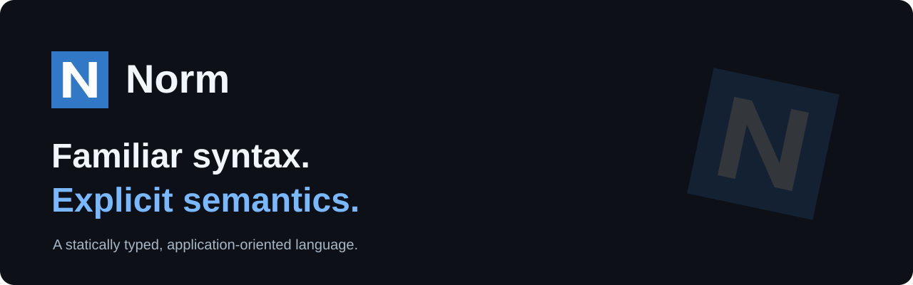

<p align="center">
  
</p>

<p align="center">
  <a href="https://normlanguage.github.io/Norm/learn/">Learn Norm</a> ·
  <a href="https://normlanguage.github.io/Norm/spec/language-spec">Language reference</a> ·
  <a href="https://github.com/normlanguage/examples">Examples</a> ·
  <a href="https://github.com/normlanguage/Norm/releases">Releases</a> ·
  <a href="README.zh-CN.md">简体中文</a>
</p>

# Norm

Norm is a statically typed, application-oriented programming language with familiar syntax and explicit semantics.

Use `class` for identity, `value` for data, `enum` for alternatives, `interface` for capabilities, and `ref` for controlled aliasing. Explore the [language tour](https://normlanguage.github.io/Norm/learn/) through executable examples.

```norm
main() {
  printLine("Hello, Norm")
}
```

[Run this example](norm/tests/docs/showcase/simple.norm) · [Explore application examples](https://github.com/normlanguage/examples)

## Get started

- **Learn the language:** follow the [learning path](https://normlanguage.github.io/Norm/learn/).
- **Get the tools:** find the CLI and matching VS Code extension in [releases](https://github.com/normlanguage/Norm/releases). See the [distribution guide](docs/design/distribution-source-build.md) for source builds.
- **Build an application:** explore [examples](https://github.com/normlanguage/examples) and the [package registry](https://github.com/normlanguage/registry).

**Active development.** Check the [current status](https://normlanguage.github.io/Norm/status) and [version index](https://normlanguage.github.io/Norm/versions/) for delivered capabilities and implementation boundaries.

## Explore

| Start here | Find |
| --- | --- |
| [Language reference](https://normlanguage.github.io/Norm/spec/language-spec) | Language rules and semantics |
| [Standard library](https://normlanguage.github.io/Norm/stdlib/overview) | Core types and library APIs |
| [Agent tools](https://normlanguage.github.io/Norm/tooling/agent) | Inspect, refactor, and verify Norm code |
| [Awesome Norm](https://github.com/normlanguage/awesome-norm) | Projects and ecosystem resources |
| [Norm Skill](https://github.com/normlanguage/Norm-Skill) | Reference-driven guidance for coding agents |

## Work on Norm

This repository contains the language specification, compiler and CLI, standard library, VS Code extension, documentation, and tests. Application examples and ecosystem acceptance live in [examples](https://github.com/normlanguage/examples); adapter packages are maintained independently in the [Norm organization](https://github.com/normlanguage).

| Source | Entry point |
| --- | --- |
| Compiler, runtime, and CLI | [cli/compiler](cli/compiler/) |
| Editor extension | [cli/extensions/vscode](cli/extensions/vscode/) |
| Standard library | [norm/stdlib](norm/stdlib/) |
| Executable language tests | [norm/tests](norm/tests/) |
| Documentation and checked examples | [docs](docs/) · [norm/tests/docs](norm/tests/docs/) |

Read the [compiler architecture](https://normlanguage.github.io/Norm/spec/compiler-design), [implementation strategy](https://normlanguage.github.io/Norm/design/implementation-strategy), and [contribution guide](https://normlanguage.github.io/Norm/community). Report problems with a minimal example in [Issues](https://github.com/normlanguage/Norm/issues).

## License

[MPL-2.0](LICENSE). See [licensing scope and source availability](LICENSING.md).
